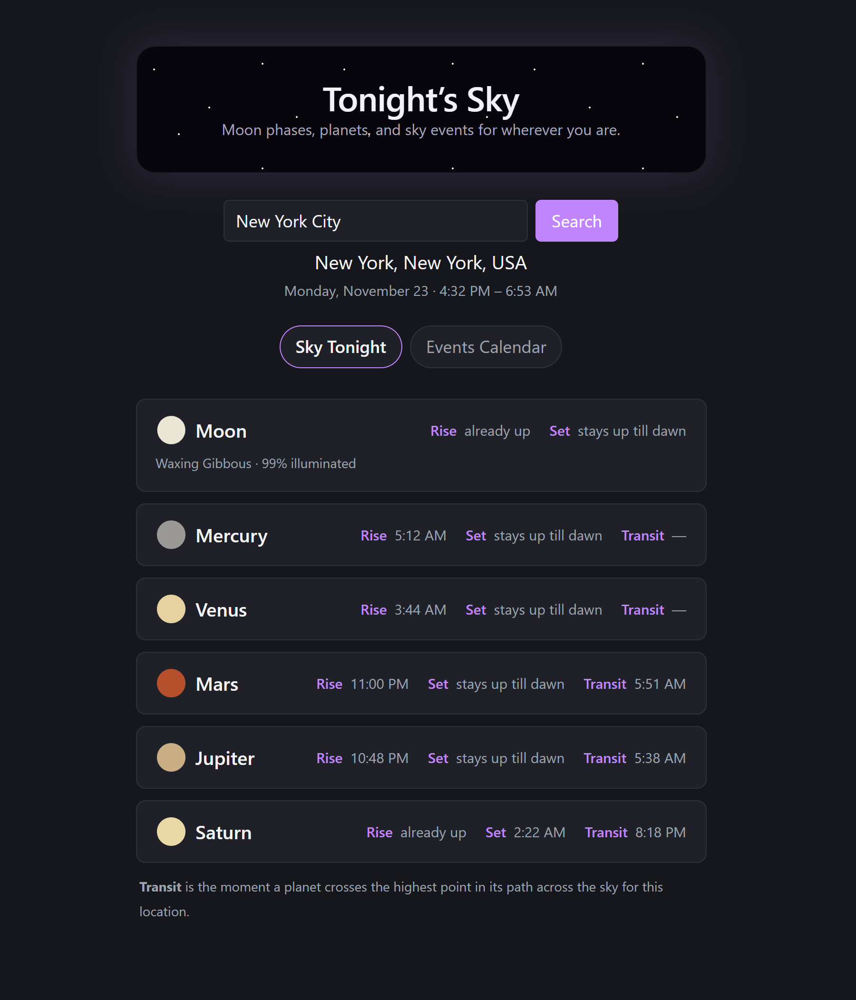

# astro.phase

A personal, portfolio-quality web app that shows what's in the night sky for any
place you type in: tonight's planets and Moon, plus a calendar of the sky events
coming up over the next three months.

**Live demo:** https://cd-aponte-dev.github.io/astro.phase/



## Features

Start typing a place and pick from the suggestions. Every time shown is in that
place's own local time, not your browser's.

### Sky Tonight

Tonight's window (sunset to sunrise) for the Moon and the five naked-eye planets:

- Rise, set, and (for planets) transit times, with an explicit "not up tonight"
  state for anything that never clears the horizon
- The Moon's phase and illumination, drawn as an accurately shaded disc

### Events Calendar

A month-by-month calendar covering the next 90 days. Click a day for details.

| Event | What's shown |
|---|---|
| **ISS passes** | Passes visible from your location over the next 5 days, with rise, peak elevation and set times |
| **Full moons** | Every full moon, flagged when it's a supermoon, blue moon, or harvest moon |
| **Lunar eclipses** | Kind and peak time, and whether the Moon is up at your location |
| **Solar eclipses** | Kind, obscuration and peak time, computed for your location |
| **Meteor showers** | Peak night and expected rate (ZHR) for the major annual showers |
| **Rocket launches** | Upcoming launches worldwide with a confirmed date, from every provider |

The legend doubles as a filter. Toggle each event type on or off, and expand
"Rocket launch" to filter by launch provider.

## How it works

Everything runs client-side, with no backend.

- **Astronomy:** [`astronomy-engine`](https://github.com/cosinekitty/astronomy)
  computes rise, set and transit times, Moon phases, full moons, lunar apsides
  and eclipses from pure geometry. A body counts as "up" once it's above 0°
  altitude, with no modelling of weather, light pollution or equipment.
- **ISS passes:** [`satellite.js`](https://github.com/shashwatak/satellite-js)
  propagates the ISS orbit from its latest TLE. A pass counts as visible when the
  ISS is in sunlight while your sky is at least civil-twilight dark.
- **Meteor showers:** a curated list of major showers from the International
  Meteor Organization (IMO), since peak dates aren't derived from orbital
  mechanics.
- **Place search:** place names are resolved to coordinates with the
  [LocationIQ](https://locationiq.com/) Search API, suggesting matches as you type.
- **Timezones:** the searched place's IANA timezone is looked up offline with
  [`@photostructure/tz-lookup`](https://github.com/photostructure/tz-lookup) and
  used to format every timestamp with `Intl.DateTimeFormat`.

### Data snapshots

The ISS orbit ([Celestrak](https://celestrak.org/)) and the launch schedule
([Launch Library 2](https://thespacedevs.com/llapi)) come from rate-limited
APIs, so visitors' browsers never call them. Every 6 hours,
[`.github/workflows/refresh-data.yml`](.github/workflows/refresh-data.yml) runs
the scripts in [`scripts/`](scripts/) and commits fresh snapshots to
`src/data/`. If anything changed, it rebuilds and redeploys the site.

## Stack

TypeScript, React, Vite. Tested with Vitest and linted with oxlint.

## Setup

```bash
npm install
```

Copy `.env.local.example` to `.env.local` and fill in a
[LocationIQ](https://locationiq.com/) API key (the free tier is enough):

```bash
cp .env.local.example .env.local
```

## Scripts

```bash
npm run dev      # start the dev server
npm test         # run the test suite
npm run lint     # lint with oxlint
npm run build    # type-check and build to dist/
```

To refresh the data snapshots locally:

```bash
node scripts/fetch-iss-tle.mjs
node scripts/fetch-rocket-launches.mjs
```

## Deploy

Pushing to `main` builds the app and publishes it to GitHub Pages via
[`.github/workflows/deploy.yml`](.github/workflows/deploy.yml). The data-refresh
workflow also calls it after each snapshot update.

The build needs a repository secret named `VITE_LOCATIONIQ_API_KEY` (Settings →
Secrets and variables → Actions). It isn't committed anywhere, because it
authorizes API usage.
